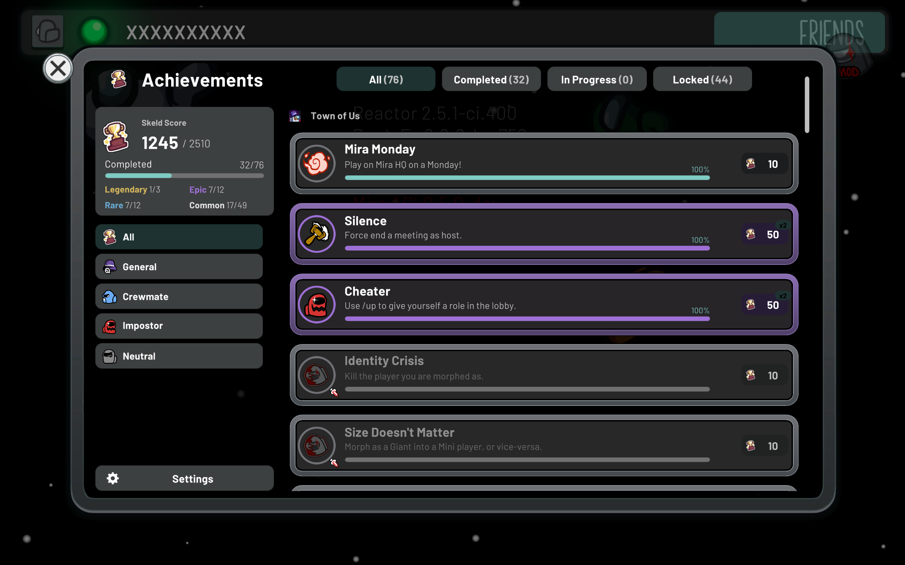
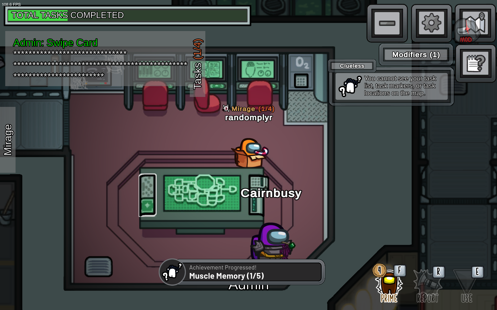
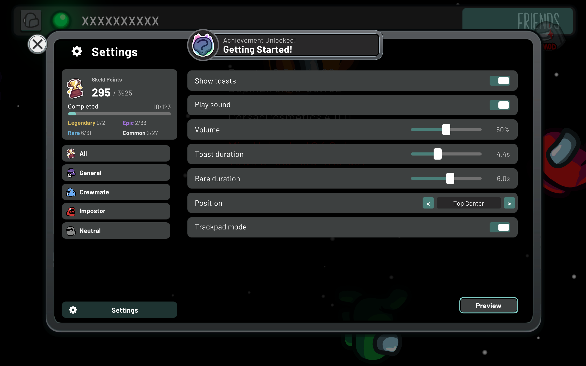

<div align="center">

# Achievements API

An Among Us modding API that lets any mod register custom achievements, with a full in-game menu and Xbox-style toast notifications.

[](LICENSE)
[](https://dotnet.microsoft.com)
[](https://discord.gg/RJyNm9UaT7)

</div>

## Features

- Easy implementation: declare achievements as properties on a tab and they are picked up automatically
- Progressable achievements with persistent counters
- Hidden achievements, rarities and Skeld Points
- An in-game menu with categories, details pages and toast settings
- Xbox-style toast notifications with sound, animations and swipe-away support
- Full mouse, keyboard and controller support
- Encrypted save data that survives updates

## Screenshots

<div align="center">
  
  <br />
  <sub>The main achievements menu, with categories, progress bars and the Skeld Points card.</sub>
  <br /><br />
  <table>
    <tr>
      <td align="center">
        <br />
        <sub>A toast popping up mid-game as progress is made.</sub>
      </td>
      <td align="center">
        <br />
        <sub>Toast settings, editable in game with a live preview.</sub>
      </td>
    </tr>
  </table>
</div>

## Getting started

There are two ways to use the Achievements API, depending on whether you want to ship it as a required mod or keep it optional for your players.

### Hard dependency (recommended for most mods)

Reference `AchievementsAPI` from your mod and subclass `AchievementsTab`. Achievements are declared as properties and discovered automatically when your plugin loads. This gives you full compile-time type safety and the simplest API:

```csharp
using Reactor.Localization.Utilities;

[BepInAutoPlugin]
[BepInDependency(AchievementsAPIPlugin.Id)] // RequiredDependency (default)
public class MyPlugin : BasePlugin
{
    public override void Load() { }
}

public class MyTab : AchievementsTab
{
    private static readonly StringNames tabName = CustomStringName.CreateAndRegister("My Mod");
    private static readonly StringNames firstWin = CustomStringName.CreateAndRegister("First Win");
    private static readonly StringNames firstWinDesc = CustomStringName.CreateAndRegister("Win a game.");
    private static readonly StringNames busyBee = CustomStringName.CreateAndRegister("Busy Bee");
    private static readonly StringNames busyBeeDesc = CustomStringName.CreateAndRegister("Complete 10 tasks.");

    public override StringNames Name => tabName;
    public override string IconPath => "MyMod.Resources.Icon.png";

    public BaseAchievement FirstWin { get; set; } =
        new(firstWin, firstWinDesc, "MyMod.Resources.FirstWin.png", rarity: 1);

    public CountAchievement TenTasks { get; set; } =
        new(busyBee, busyBeeDesc, "MyMod.Resources.Tasks.png", 0, 10);
}
```

Unlock an achievement with `achievement.Unlock()`. For a `CountAchievement`, use `Increment(amount)` or `SetValue(value)`; it unlocks on its own once `RequiredValue` is reached.

The icon can be an embedded resource path or a `Sprite`. Constructor options cover rarity (0 common, 1 rare, 2 epic, 3 legendary), `hidden`, `hideRarity`, and for count achievements `hideProgress` and how progress persists (`AchPersistence`).

### Soft dependency (optional Achievements API)

If you want users to run your mod **without** Achievements API installed, you can keep it as a `SoftDependency` and use runtime-constructed achievements instead of subclasses. This is the pattern used by [Town of Us Mira](https://github.com/AtonyGit/TOU-Mira) and [Mira Unleashed](https://github.com/AtonyGit/TownOfUsMiraUnleashed).

Mark the dependency soft in your plugin and register tabs/achievements only when the plugin is actually loaded:

```csharp
using BepInEx.Unity.IL2CPP;

[BepInAutoPlugin]
[BepInDependency("AchievementsAPI", BepInDependency.DependencyFlags.SoftDependency)]
public class MyPlugin : BasePlugin
{
    public override void Load()
    {
        if (!IL2CPPChainloader.Instance.Plugins.ContainsKey("AchievementsAPI"))
        {
            return;
        }

        RegisterAchievements(); // safe to touch API types now
    }
}
```

Because `AchievementsTab` subclasses in your assembly are still touched by BepInEx/MiraAPI assembly scanning, use `SoftAchievementsTab` + `RuntimeAchievement`/`RuntimeCountAchievement` instead of deriving your own classes:

```csharp
// Only call this method when the plugin is loaded (the JIT won't resolve the
// AchievementsAPI types until this frame actually executes).
private void RegisterAchievements()
{
    var tab = new SoftAchievementsTab("My Mod", categoryId: "general");
    AchievementsManager.RegisterTab(tab);

    tab.RegisterAchievement(new RuntimeAchievement("First Win", "Win a game.", rarity: 1,
        assembly: typeof(MyPlugin).Assembly));

    tab.RegisterAchievement(new RuntimeCountAchievement("Busy Bee", "Complete 10 tasks.", 0, 10,
        AchPersistence.ThroughoutRounds, rarity: 1, assembly: typeof(MyPlugin).Assembly));
}
```

Pass your own assembly so achievement ids stay stable (`{AssemblyName}_{AchievementName}`), and prefer descriptor-driven code so the registration paths stay separate from gameplay logic. If you want a ready-made helper for this, see `TownOfUs.Achievements.AchievementsAPIHelper` in TOU-Mira.

## Localization

Tab names, achievement names and descriptions, and category names are stored as Reactor `StringNames`, not raw strings. The menu and toasts resolve them through the game's translation system (patched by Reactor's `LocalizationManager`) every time they render, so translations kick in automatically — no need to modify achievements at runtime.

Pass any `StringNames` you like:

- a built-in game one, e.g. `StringNames.Crewmate`;
- one made with `CustomStringName.CreateAndRegister("...")`, which registers the given text as the hard-coded English fallback;
- or one backed by a `Reactor.Localization.LocalizationProvider` (your own, or one from an API like MiraAPI) for real translations.

Plain `string` constructors are still available and register the text as a hard-coded English string the same way. `AchievementsStrings` holds the API's own labels (toast titles, filters, categories, ...) as `StringNames` you can translate too.

Resolve text in code with `AchievementsStrings.GetText(stringName)` or the `GetName()`/`GetDescription()` helpers on achievements. The `Id` used for save files never depends on the language: for string-based achievements it contains the raw text, for `StringNames`-based ones the enum value — so create your `StringNames` deterministically (e.g. all at plugin load) to keep saves stable.

### Soft-registered achievements

Register achievements at runtime without declaring properties on a tab:

```csharp
var tab = new SoftAchievementsTab(CustomStringName.CreateAndRegister("My Tab"));
AchievementsManager.RegisterTab(tab);
tab.RegisterAchievement(myAchievement);
```

Use `AchievementsManager.GetTab(stringName)` to look up a tab and `tab.GetAchievements()` to enumerate everything on it.

### Categories

Every tab belongs to a category (`CategoryId`, defaulting to General). Crewmate, Impostor and Neutral are built in, and mods can add their own with `AchievementsManager.GetOrCreateCategory(id, name, icon, order)`. Individual achievements can override their tab's category through `Category`.

### Hidden achievements

Hidden achievements show as "Hidden Achievement" in the menu and in progress toasts until they are unlocked. Set `HideRarity` to also hide the rarity tint and `HideProgress` to hide the progress bar. Hidden achievements are worth double Skeld Points.

### Skeld Points

Each achievement is worth Skeld Points based on rarity (10 common / 25 rare / 50 epic / 100 legendary); override `BasePoints` or `PointsMultiplier` to customize. The menu shows earned and total score next to a Gamerscore-style emblem, plus per-rarity completion, and each row shows its value in a pill.

### Reset triggers

Set `ResetTrigger` on any achievement to automatically reset it:

- `AchResetTrigger.Never` (default), `OnGameEnd`, `OnMeetingStart`, `OnMeetingEnd`, `OnRoundStart`

Resetting clears `Unlocked` (and `CurrentValue` for `CountAchievement`) and writes through to storage. You can also call `achievement.Reset()` manually.

### Deferred toasts

Set `ToastTiming` to control when an achievement's toast appears:

- `AchToastTiming.Immediate` (default), `OnRoundStart`, `OnMeetingStart`, `OnMeetingEnd`, `OnGameEnd`

Deferred toasts are queued and flushed at the matching game event, shown one at a time.

## The menu

The achievements button on the main menu opens a full-screen menu that lists every registered achievement grouped by mod. It has:

- Filters for All, Completed, In Progress and Locked
- A category column with paging for mods that register many categories
- A details page for each achievement with its unlock time
- A settings page for toasts
- A stats card with Skeld Points and per-rarity completion

While the menu or a toast has the pointer, clicks do not reach the game UI behind it.

### Controller and keyboard

The menu can be driven entirely without a mouse. A focus ring shows the current selection and the list scrolls to keep it visible.

| Action | Controller | Keyboard |
| --- | --- | --- |
| Move | Left stick / D-pad | Arrow keys |
| Select | A | Enter / Space |
| Back / Close | B | Escape |
| Previous / next category | LB / RB | Q / E |
| Previous / next filter | LT / RT | Shift+Tab / Tab |

Moving the mouse switches back to pointer mode.

## Toasts

Toasts slide in from the configured screen edge and play a chime (a different one for rare and above). They can be swiped away sideways. Middle-clicking a toast opens the achievements menu; on a controller hold Y while the toast is visible. Trackpad users can turn on `TrackpadMode` to open the menu with a normal click instead.

### Configuration

Toast settings live in the "Toasts" section of the plugin config and can also be changed from the Settings page in the menu:

| Setting | Default | Description |
| --- | --- | --- |
| `ToastsEnabled` | `true` | Show toast popups |
| `ToastDuration` | `4.4` | Seconds a toast stays fully visible |
| `RareToastDuration` | `6.0` | Same, for rarity above common |
| `ToastSoundEnabled` | `true` | Play the unlock chime |
| `ToastVolume` | `0.5` | Chime volume |
| `Position` | `BottomCenter` | Screen corner or edge the toast uses |
| `TrackpadMode` | `false` | Open the menu from a toast with a normal click |

## Storage

Progress is saved to `AchievementsAPIData/achievements.json` in the game's persistent data folder, encrypted and signed so it cannot be edited by hand. Unlocks are written immediately; progress updates are batched so frequent increments do not cause stutter.

## Building

The solution targets .NET 6 and builds with `dotnet build AchievementsAPI.sln`. CI runs `build.cake` and uploads `AchievementsAPI.dll` as an artifact.

## Credits

- **satire ([rewalo](https://github.com/rewalo))**: UI design, UI code, toast design, toast code and animations, optimizations and much more. The mod would not look or feel the way it does without him.
- **[atony](https://github.com/AtonyGit)**: UI design and achievements system improvements.
- **[pix](https://github.com/wanderingpix)**: for the help along the way.

## Support

For support, or just chatting, join the [Discord](https://discord.gg/RJyNm9UaT7)!

> [!NOTE]
> This mod is not affiliated with Among Us or Innersloth LLC, and the content contained therein is not endorsed or otherwise sponsored by Innersloth LLC. Portions of the materials contained herein are property of Innersloth LLC. © Innersloth LLC.
